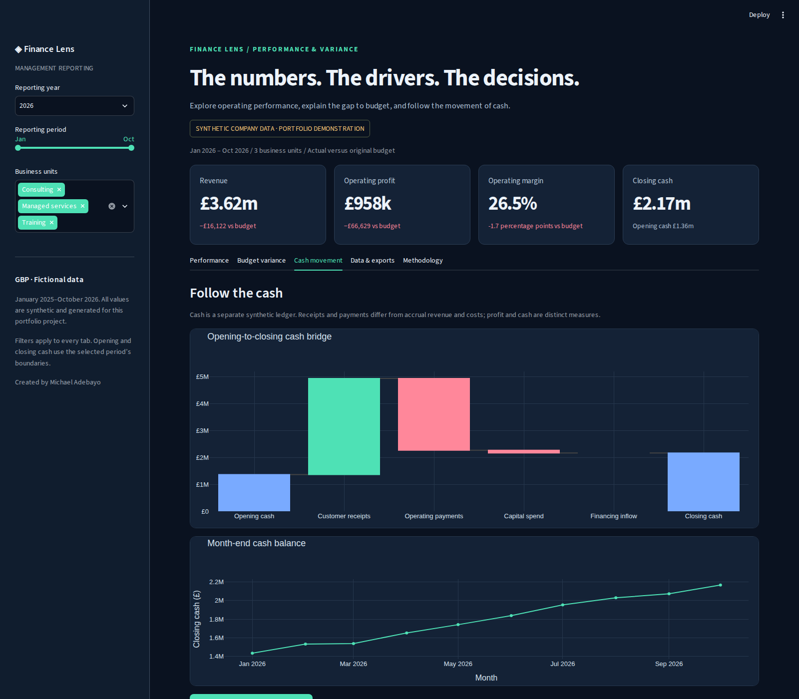

# Finance Lens — Financial Performance & Budget Variance

A finance analyst portfolio project by **Michael Adebayo**, combining financial reporting experience with Python analytics. The Streamlit dashboard explores a fictional company's operating performance, budget variances and cash movements across Consulting, Managed services and Training.

**All company data, budgets, results and business units are synthetic.** No employer, client or personal financial records are used. The project is a management-reporting demonstration, not a real company case study or an investment analysis.

## What an analyst can do

- Filter the reporting year, a continuous month range and one or more business units.
- Compare revenue, operating profit and operating margin with the original budget.
- Explain the difference between budget and actual profit using an additive waterfall.
- Inspect an eight-line management P&L with monetary and percentage variances.
- Distinguish favourable cost savings from adverse overspending.
- Reconcile opening cash to closing cash and inspect month-end balances.
- Trace KPIs to underlying records and download the selected P&L, ledger or cash movements.
- Review definitions, assumptions and data-validation checks inside the app.

The methodology and synthetic-data status stay visible throughout the experience. Sidebar filters apply to all tabs; account/scenario filters in Data & exports affect only its table and download.

## Screenshots




Mobile captures: [performance](screenshots/mobile-performance.png) and [CSV export](screenshots/mobile-export.png).

## Data and generation

Bundled CSVs contain **660 management-account records** and **66 monthly cash records**, covering January 2025–October 2026, three business units and GBP amounts.

- `data/management_accounts.csv`: `month`, `business_unit`, `category`, `scenario`, `amount_gbp`.
- `data/cash_movements.csv`: `month`, `business_unit`, opening cash, customer receipts, operating payments, capital spend, financing inflow and closing cash, all in GBP.

Every month/business-unit/category has one Actual record and one Budget record. The categories are Revenue, Direct costs, People, Sales & marketing and Administration. Amounts are stored as positive magnitudes; costs are subtracted when calculating profit.

`generate_data.py` creates the two CSVs using NumPy seed **20261122**. The synthetic budget combines business-unit baselines, growth and seasonality; the synthetic actual scenario adds deterministic seeded variation and a fictional Training revenue shortfall in 2026. Cash receipts/payments are separately generated around operating activity and reconciled month to month. These are illustrative modelling choices, not observed business facts.

The dataset's source is the included generator. No external financial dataset or third-party dataset licence is claimed. No software licence has been assigned on the owner's behalf.

## Financial definitions

| Metric | Calculation |
|---|---|
| Gross profit | Revenue − Direct costs |
| Operating costs | People + Sales & marketing + Administration |
| Operating profit | Gross profit − Operating costs |
| Operating margin | Operating profit ÷ Revenue × 100 |
| Monetary variance | Actual − Budget |
| Percentage variance | (Actual − Budget) ÷ Budget × 100; N/A for zero budget |
| Profit impact | Monetary variance for revenue; reversed monetary variance for costs |
| Cash bridge | Opening + Receipts − Operating payments − Capital spend + Financing inflow = Closing |

Operating margin variance is expressed in **percentage points**. Period margins use aggregated profit and revenue, not an unweighted mean of monthly margins. Positive profit impacts are favourable; negative impacts are adverse. The label describes the arithmetic comparison and does not establish whether a management decision was beneficial.

The profit bridge includes each underlying category once; it excludes subtotals to avoid double counting. Period cash uses the first opening balance and final closing balance, rather than summing monthly balances. Unit-level cash allocations are additive illustrations; no intercompany transactions or consolidation adjustments are modelled.

The P&L is simplified: tax, interest, a depreciation schedule and a full balance sheet are not modelled. Operating profit is **not net income**. Cash movements are not a statutory cash-flow statement or a forecast. The commentary identifies the largest adverse category contribution; aggregate data do not establish causes or support invoice-level conclusions.

## Run locally

Use Python **3.12**, matching the validated environment:

```bash
cd finance-performance-dashboard
python3.12 -m venv .venv
source .venv/bin/activate
python -m pip install -r requirements.txt
python -m streamlit run app.py --server.port 8602
```

Open http://localhost:8602. All file paths resolve relative to the Python modules; no hardcoded user directory is used in the application.

Regenerating the data is optional because both CSVs are included:

```bash
python generate_data.py
```

## Validate

```bash
python -m unittest discover -s tests -v
python -m pip check
```

The six financial tests cover the operating profit identity, an independently reconciled profit bridge, favourable/adverse signs, zero-budget percentages, cash period boundaries, monthly aggregation, business-unit additivity and rejection of broken cash/incomplete budgets. See [VALIDATION.md](VALIDATION.md) for app and browser checks actually executed.

## Project structure

```text
finance-performance-dashboard/
├── app.py
├── finance.py
├── generate_data.py
├── requirements.txt
├── README.md
├── VALIDATION.md
├── .gitignore
├── .streamlit/config.toml
├── data/
│   ├── management_accounts.csv
│   └── cash_movements.csv
├── screenshots/
└── tests/test_finance.py
```

Technologies: Python, Streamlit, Pandas, NumPy and Plotly. The native dark theme uses a navy background with mint, blue and warm-gold accents. Direct dependencies are pinned to the versions used for local verification.

## Deployment preparation

The project is prepared for a repository named `finance-performance-dashboard`, branch `main`, entrypoint `app.py`, Python **3.12** and Streamlit Community Cloud. It requires no secrets or database service. All generated data are bundled locally.

Publication status: **local project; no public repository or deployed URL yet**. After owner approval, push the reviewed files to a new GitHub repository, then select that repository, `main` and `app.py` in Community Cloud. Choose Python 3.12 in Advanced settings. Inspect the cloud build/runtime logs and test the returned public app URL before recording deployment as complete. A local browser test does not establish a successful cloud build.

## Portfolio discussion points

Explain the difference between profit and cash, why higher costs are adverse, how the waterfall reconciles, how zero budgets are treated, and which controls prevent incomplete data from silently changing results. The project demonstrates traceable financial analysis and reproducibility rather than claiming a commercial saving or real-world performance improvement.

[Connect with Michael on LinkedIn](https://www.linkedin.com/in/michael-adebayo-223b0722/)
