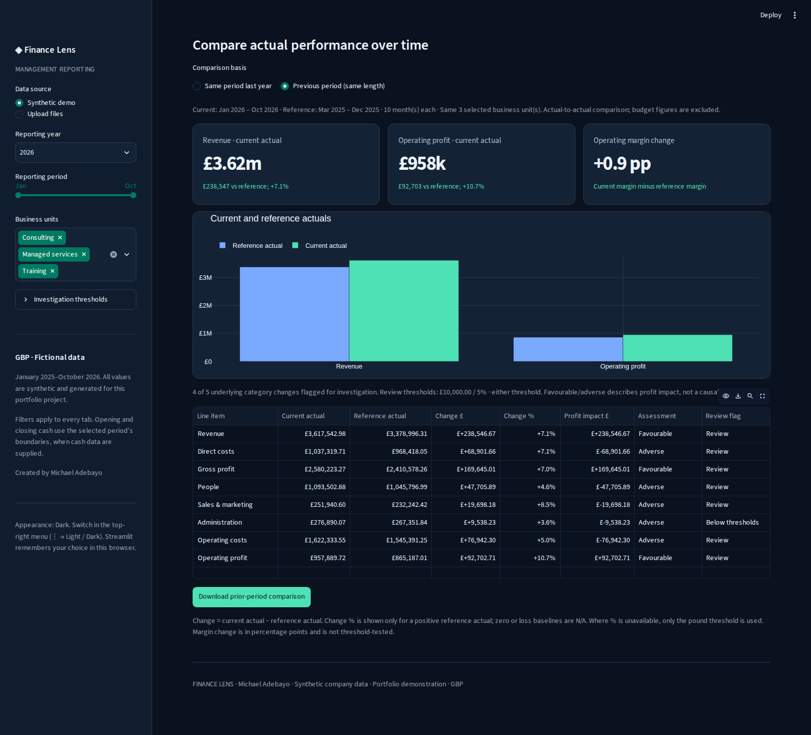
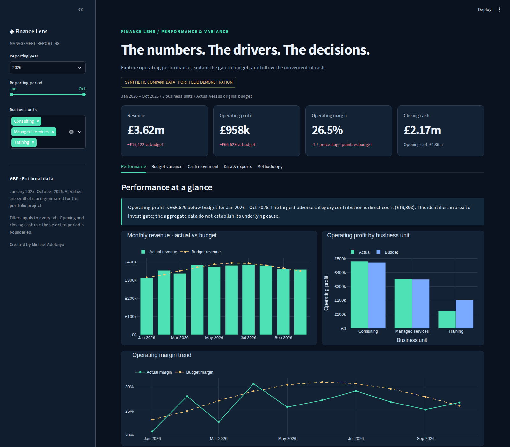
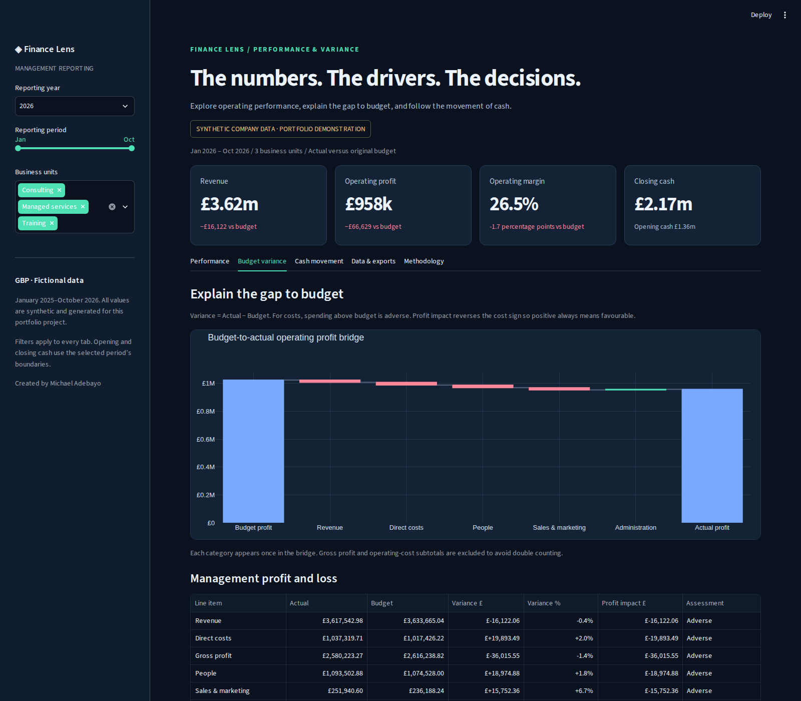

# Finance Lens — Financial Performance & Budget Variance

A finance analyst portfolio project by **Michael Adebayo**, combining financial reporting experience with Python analytics. The Streamlit dashboard supports both a reproducible fictional-company demo and session-only uploads of monthly financial totals for operating performance, budget variance and cash analysis.

**Bundled demo data are synthetic.** Upload mode uses only the records explicitly mapped, validated and applied by the viewer. Demo and uploaded records are never mixed. The application is a simplified management-reporting tool, not audited financial statements or investment analysis.

**Live application:** [Open Finance Lens](https://finance-performance-dashboard-kfcrjeb9zde6gvyr22mwbc.streamlit.app/)

## What an analyst can do

- Filter the reporting year, a continuous month range and one or more business units.
- Compare revenue, operating profit and operating margin with the original budget.
- Explain the difference between budget and actual profit using an additive waterfall.
- Inspect an eight-line management P&L with monetary and percentage variances.
- Distinguish favourable cost savings from adverse overspending.
- Reconcile opening cash to closing cash and inspect month-end balances.
- Trace KPIs to underlying records and download the selected P&L, ledger or cash movements.
- Review definitions, assumptions and data-validation checks inside the app.

The methodology and current data-source status stay visible throughout the experience. Sidebar filters apply to all tabs; account/scenario filters in Data & exports affect only its table and download.

## Prior periods and investigation thresholds

Open **Prior periods** and choose:

- **Same period last year:** the same selected months, shifted back 12 months.
- **Previous period (same length):** the consecutive block immediately before the selected period. For January–March 2026, this is October–December 2025.

Comparisons use **Actual versus Actual**, the same selected business units and the same number of months. The reference can cross year boundaries and comes only from the active data source. Every required reference month/unit/category Actual record must exist; otherwise the app explains what is missing and displays no partial or inferred-zero comparison. A one-period upload without reference history therefore remains usable for P&L/budget analysis but has no prior-period comparison.

Change is current actual minus reference actual. Change percentages are shown only where the reference actual is positive; zero or negative reference values are N/A, with monetary changes still available. Operating margin change is calculated from each period's aggregated profit/revenue and shown in **percentage points**.

In the sidebar, expand **Investigation thresholds** to set a pound limit, percentage limit and rule:

| Rule | Nonzero line is flagged when |
|---|---|
| Either threshold | Absolute monetary change meets the pound limit **or** absolute percentage change meets the percentage limit |
| Both thresholds | Both limits are met where the percentage is available |
| Percentage unavailable | The pound limit alone is used under either rule, labelled explicitly |

Limits are inclusive (equal to the threshold counts); zero-change lines are never flagged. A zero threshold is a minimum of zero, not a disabled test. Defaults are £10,000 and 5%, using Either threshold. These are user-defined investigation settings, **not statutory materiality or an audit conclusion**.

Review flags appear in budget and prior-period P&L tables without filtering or changing figures. Counts cover the five underlying account categories; gross profit/operating-cost/operating-profit subtotals are not double counted. Margin changes are descriptive and are not threshold-tested.

The comparison CSV includes both period boundaries, basis, selected units and threshold settings. The existing P&L download also includes its reporting period and review settings for traceability.



[Mobile comparison view](screenshots/prior-periods-mobile.png).

## Upload your data

CSV and Excel upload workflows were verified on the public app on **23 November 2026**, using only synthetic template data.

Choose **Data source → Upload files** in the sidebar. Download the Accounts CSV, Cash CSV or Excel templates from the import panel. Use authorised, anonymised company-level totals; do not include customer, employee, bank-account or other personal identifiers.

1. Upload a **CSV or .xlsx** file. Choose the appropriate Excel sheet when needed.
2. Choose **Wide** layout (separate actual and budget columns) or **Long** layout (scenario and amount columns).
3. Map each required field to a distinct source column. Map source account names to the five supported categories. In Long layout, map scenario labels to Actual/Budget.
4. Select the explicit date format. Confirm GBP if there is no currency column, or map a column containing GBP for every row.
5. Optionally upload a separate cash file; the same Excel workbook can be uploaded to both inputs with different sheets selected.
6. Select **Validate and preview**. Review the normalised records and P&L totals.
7. Select **Use validated data** to analyse the records. Editing a file or mapping invalidates the previous preview/applied dataset; it never silently continues using old totals.
8. Use **Clear uploaded data**, or return to Synthetic demo, to reset the upload controls and remove the app's uploaded-data session references.

### Supported input

- Maximum **5 MB per file**, **10,000 data rows**, **30 columns**, 20 Excel sheets and 50 MB expanded workbook size.
- UTF-8 comma-separated CSV with one unique, nonempty header row. XLSX sheets must contain values, not formulas; encrypted workbooks, macros and legacy `.xls` are unsupported. Paste calculated values into a clean sheet first.
- Consecutive reporting months (at most 120), at most 50 business units, with a complete Actual/Budget comparison for every unit/category/month. This is a monthly summary importer, not an invoice or transaction importer.
- Dates: `YYYY-MM`, `YYYY-MM-DD`, `DD/MM/YYYY`, `MM/DD/YYYY`, or native Excel date cells. Dates are normalised to month starts; no ambiguous date-format inference is used. Supported years: 2000–2100.
- GBP only; no currency conversion. Amounts are pounds, not thousands, with up to two decimal places, without currency symbols or thousands separators in text. Revenue and costs must be nonnegative magnitudes. There is no automatic sign reversal or netting of negative ledger rows.
- Multiple distinct source accounts may map to the same P&L category; their amounts are explicitly summed. Duplicate month/unit/source-account/scenario rows are rejected first. Missing values, nonfinite numbers and incomplete comparisons are rejected.
- Unused categories are zero-filled **only if explicitly selected** and only when absent from the entire file; missing scenario pairs/periods are not inferred. Use explicit zero rows for no-activity periods.
- Cash must cover the exact imported month/unit combinations, reconcile opening-to-closing within £0.01 and carry the previous closing balance into the next opening. Receipts/payments/capital spend/financing inflow are nonnegative; opening/closing balances may represent an overdraft. The current cash model does not separately support dividends, financing repayments or FX movements.
- Labels cannot start with spreadsheet formula prefixes or contain control characters. CSV exports also escape formula prefixes in text; numeric negative financial values are preserved.

**No cash file?** P&L analysis still works. Closing cash displays **Not supplied**, and the cash tab explains why it is unavailable. Synthetic cash is never substituted and cash balances are not inferred from profit.

### Wide accounts template

| month | business_unit | category | actual | budget | currency |
|---|---|---|---:|---:|---|
| 2026-01 | Example unit | Revenue | 100000 | 95000 | GBP |
| 2026-01 | Example unit | Direct costs | 30000 | 28000 | GBP |
| 2026-01 | Example unit | People | 25000 | 26000 | GBP |
| 2026-01 | Example unit | Sales & marketing | 5000 | 4500 | GBP |
| 2026-01 | Example unit | Administration | 10000 | 11000 | GBP |

Long layout replaces `actual`/`budget` with `scenario`/`amount_gbp`, with one Actual and one Budget row per account/month/unit. Category names can differ in your file as long as all source labels are mapped explicitly.

See [DATA_HANDLING.md](DATA_HANDLING.md) for actual data handling, session lifetime and hosting limits.

## Light and dark appearance

Use the **top-right menu (⋮) → Light / Dark** to change appearance. The sidebar shows the current mode. Native Streamlit theming updates dropdowns, multi-select tags, sliders, data tables and dialogs together; custom KPI cards and Plotly charts follow the same mode. A lightweight session-local fragment detects appearance changes and refreshes custom visuals within about one second while the app is active.

The dark navy design remains the configured base. Streamlit respects the viewer's saved preference or device appearance when System is selected, so a light-mode device can open in light mode. A manual choice is saved in that browser. Theme choice is independent for each viewer and changes presentation only; it does not reset filters or alter calculations/downloads.

Both modes use green for favourable contributions and red for adverse contributions, with signed values and assessment labels alongside colour. Light mode uses darker accents for legibility on pale backgrounds.

## Screenshots

Upload examples use only the supplied synthetic template: [validation preview](screenshots/upload-preview.png), [uploaded dashboard](screenshots/uploaded-performance-light.png) and [mobile view](screenshots/mobile-uploaded.png).






Light mode: [performance](screenshots/performance-light.png), [budget variance](screenshots/budget-variance-light.png) and [data table](screenshots/data-light.png).

Mobile captures: [dark performance](screenshots/mobile-performance.png), [dark CSV export](screenshots/mobile-export.png), [light performance](screenshots/mobile-performance-light.png) and [light CSV export](screenshots/mobile-export-light.png).

## Data and generation

Bundled CSVs contain **660 management-account records** and **66 monthly cash records**, covering January 2025–October 2026, three business units and GBP amounts.

- `data/management_accounts.csv`: `month`, `business_unit`, `category`, `scenario`, `amount_gbp`.
- `data/cash_movements.csv`: `month`, `business_unit`, opening cash, customer receipts, operating payments, capital spend, financing inflow and closing cash, all in GBP.

Every month/business-unit/category has one Actual record and one Budget record. The categories are Revenue, Direct costs, People, Sales & marketing and Administration. Amounts are stored as positive magnitudes; costs are subtracted when calculating profit.

`generate_data.py` creates the two CSVs using NumPy seed **20261122**. The synthetic budget combines business-unit baselines, growth and seasonality; the synthetic actual scenario adds deterministic seeded variation and a fictional Training revenue shortfall in 2026. Cash receipts/payments are separately generated around operating activity and reconciled month to month. These are illustrative modelling choices, not observed business facts.

The dataset's source is the included generator. No external financial dataset or third-party dataset licence is claimed. No software licence has been assigned on the owner's behalf.

## Financial definitions

| Metric | Calculation |
|---|---|
| Gross profit | Revenue − Direct costs |
| Operating costs | People + Sales & marketing + Administration |
| Operating profit | Gross profit − Operating costs |
| Operating margin | Operating profit ÷ Revenue × 100 |
| Monetary variance | Actual − Budget |
| Percentage variance | (Actual − Budget) ÷ Budget × 100; N/A for zero budget |
| Profit impact | Monetary variance for revenue; reversed monetary variance for costs |
| Cash bridge | Opening + Receipts − Operating payments − Capital spend + Financing inflow = Closing |

Operating margin variance is expressed in **percentage points**. Period margins use aggregated profit and revenue, not an unweighted mean of monthly margins. Positive profit impacts are favourable; negative impacts are adverse. The label describes the arithmetic comparison and does not establish whether a management decision was beneficial.

The profit bridge includes each underlying category once; it excludes subtotals to avoid double counting. Period cash uses the first opening balance and final closing balance, rather than summing monthly balances. Unit-level cash allocations are additive illustrations; no intercompany transactions or consolidation adjustments are modelled.

Validation checks structure, completeness and mathematical consistency; it does not audit uploaded records or establish their business accuracy. The P&L is simplified: tax, interest, a depreciation schedule and a full balance sheet are not modelled. Operating profit is **not net income**. Cash movements are not a statutory cash-flow statement or a forecast. The commentary identifies the largest adverse category contribution; aggregate data do not establish causes or support invoice-level conclusions.

## Run locally

Use Python **3.12**, matching the validated environment:

```bash
cd finance-performance-dashboard
python3.12 -m venv .venv
source .venv/bin/activate
python -m pip install -r requirements.txt
python -m streamlit run app.py --server.port 8602
```

Open http://localhost:8602. All file paths resolve relative to the Python modules; no hardcoded user directory is used in the application.

Regenerating the data is optional because both CSVs are included:

```bash
python generate_data.py
```

## Validate

```bash
python -m unittest discover -s tests -v
python -m pip check
```

The financial tests cover the operating profit identity, an independently reconciled profit bridge, favourable/adverse signs, zero-budget percentages, cash period boundaries, monthly aggregation, business-unit additivity and rejection of broken cash/incomplete budgets. See [VALIDATION.md](VALIDATION.md) for app and browser checks actually executed.

## Project structure

```text
finance-performance-dashboard/
├── app.py
├── finance.py
├── comparisons.py
├── imports.py
├── upload_ui.py
├── themes.py
├── generate_data.py
├── requirements.txt
├── README.md
├── VALIDATION.md
├── .gitignore
├── .streamlit/config.toml
├── data/
│   ├── management_accounts.csv
│   └── cash_movements.csv
├── screenshots/
└── tests/
    ├── test_finance.py
    ├── test_comparisons.py
    └── test_imports.py
```

Technologies: Python, Streamlit, Pandas, NumPy and Plotly; openpyxl reads/writes Excel, with defusedxml XML parser hardening. Uploads do not require an AI service, database or additional account. Native light and dark themes share green, blue and gold accents, with contrasting foreground colours. `themes.py` defines matching custom-component and chart palettes; `.streamlit/config.toml` defines native controls. Direct dependencies are pinned to the versions used for local verification.

## GitHub and deployment

GitHub repository: [michael-adebayo256/finance-performance-dashboard](https://github.com/michael-adebayo256/finance-performance-dashboard). Deployment configuration: branch `main`, entrypoint `app.py`, Python **3.12** and Streamlit Community Cloud. It requires no secrets or database service. All generated data are bundled locally.

**Deployment status: live and browser-verified on 22 November 2026.** [Open Finance Lens](https://finance-performance-dashboard-kfcrjeb9zde6gvyr22mwbc.streamlit.app/). The public dashboard, five tabs and an actual P&L download were verified; see `VALIDATION.md` for the scope and limitations.

For redeployment:

1. Open https://share.streamlit.io/ and select the `michael-adebayo256` workspace.
2. Choose **Create app** → **Yup, I have an app**.
3. Choose **Paste GitHub URL** and paste `https://github.com/michael-adebayo256/finance-performance-dashboard/blob/main/app.py`, or enter repository `michael-adebayo256/finance-performance-dashboard`, branch `main`, main file `app.py`.
4. In **Advanced settings**, choose Python **3.12**. Leave Secrets empty.
5. Choose an available app subdomain and click **Deploy**.
6. Inspect the build/runtime logs and test the resulting public URL, filters, theme switch and downloads before marking cloud deployment verified.

[Official Community Cloud deployment instructions](https://docs.streamlit.io/deploy/streamlit-community-cloud/deploy-your-app/deploy). A local browser test does not establish a successful cloud build.

## Portfolio discussion points

Explain the difference between profit and cash, why higher costs are adverse, how the waterfall reconciles, how zero budgets are treated, and which controls prevent incomplete data from silently changing results. The project demonstrates traceable financial analysis and reproducibility rather than claiming a commercial saving or real-world performance improvement.

[Connect with Michael on LinkedIn](https://www.linkedin.com/in/michael-adebayo-223b0722/)
